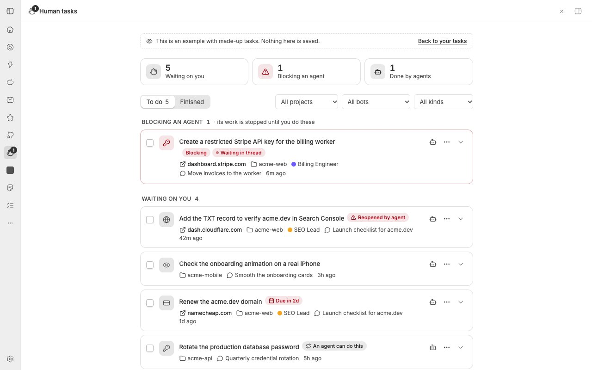
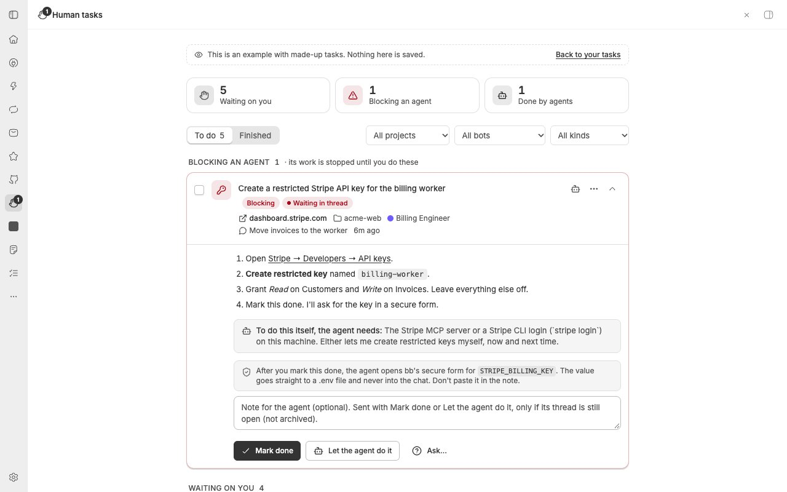
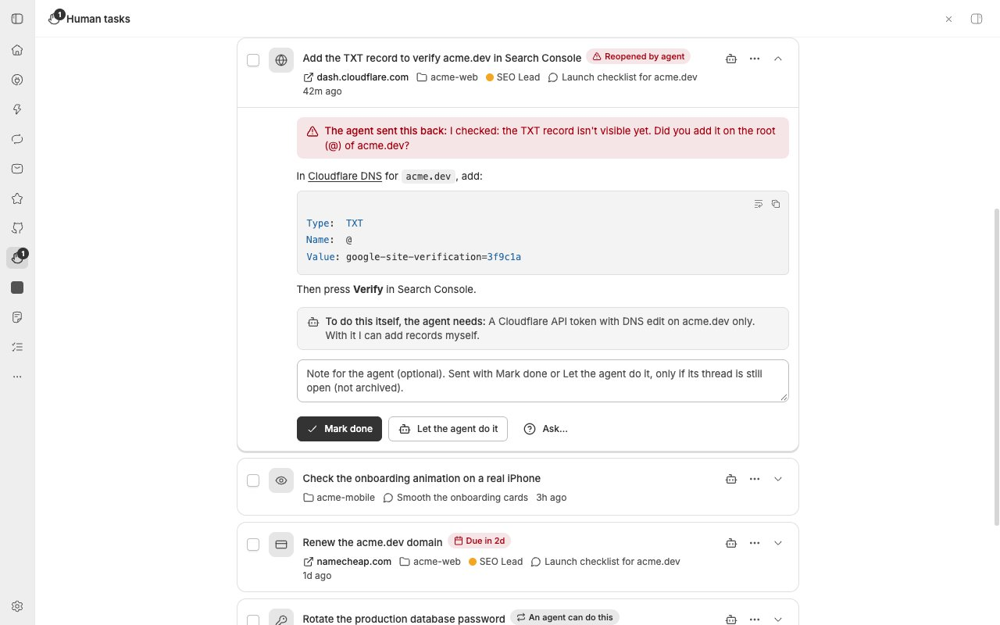

# Human tasks for bb

**The steps only you can do, handed over by your agents in one checklist. Check
one off and the agent that asked picks up where it stopped.**



Agents get stuck on things they can't do themselves: creating an API key,
adding a DNS record, renewing a domain, testing a build on a real phone,
sending an email in your name. Instead of burying the request in chat or a
`.md` file, they hand you a **human task** with steps. You work through the
list when it suits you, and the agent that asked is told the moment you finish.

## Install

```sh
bb plugin install https://github.com/kvaliotti/bb-plugin-human-tasks
```

Open **Human tasks** (the raised hand) in bb's navigation. Agents pick up the
tools and the bundled skill on their next turn; no AGENTS.md changes needed.

## What you get

- **A page of tasks** grouped into *Blocking an agent*, *Waiting on you*,
  *The agent is on it*, and *Snoozed*. Each links to the project, thread, and
  bot (with the [Bots sidebar](https://github.com/tobi/bb-bots-sidebar)
  plugin) that asked, plus the site to open. Filter by project, bot, or kind.
- **Everyday actions on each row:** check it off, open the site, let the agent
  do it, or use the menu to snooze, ask the agent, copy the steps, or dismiss.
- **The agent resumes when you finish.** Your note goes to the requesting
  thread (unless it's archived or deleted), and the task shows when the agent
  picked it back up. If the agent checks and it isn't done, it sends the task
  back with a reason. Threads that asked for the same thing all hear back.
- **You notice new tasks:** a count on the navigation icon (red while an agent
  is blocked), a toast, a system notification while bb is in the background,
  a *Waiting on you* list on the home screen, and a banner above the
  requesting thread's composer.
- **Blocking tasks wait in the thread** as bb's native input form, so the
  thread shows as waiting on you and push notifications fire.
- **Time-aware:** due dates, snooze (an hour, tomorrow, Monday, a week), and
  tasks agents hide until they can be done.
- **Credentials stay out of chat.** A task names the env vars the agent needs
  back; after you finish, the agent collects them with `bb secret request`.
  The note box warns you when you paste something that looks like a key.



## Do it, or let the agent do it

Every task says what the agent would need to do it itself, this time and next
time: an MCP server, a scoped API key, a CLI login, permission to use your
signed-in bb browser. Then you choose:

- **Mark done** after doing it yourself, or
- **Let the agent do it.** The task goes back to the agent and its thread
  opens. The agent asks there for exactly the access it needs, does the work,
  and marks the task done (or sends it back with a reason). It records how it
  got access, so the next similar task is flagged as one an agent can do.

If the agent checks your work and something is missing, it sends the task
back with the reason:



## Task kinds

| Kind | For |
| --- | --- |
| `access` | Credentials, permissions, invites |
| `setup` | Dashboards, DNS, consoles, store listings |
| `payment` | Purchases, renewals, signing terms |
| `review` | Testing on a real device, a taste or design call |
| `communicate` | Email, posts, or calls in your name |
| `physical` | Anything in the physical world |
| `other` | Anything else only you can do |

## For agents

Three tools, kept short because every thread carries them:

| Tool | What it does |
| --- | --- |
| `human_task_create` | Hand the user a task: `title`, `instructions`, `agent_needs`, `kind`, `blocking`, `reply_prompt`, `secrets` + `env_file`, `due`, `not_before`. A same-titled open task is reused instead of duplicated. |
| `human_task_update` | Act on a task this thread created. `action`: `edit` (default), `dismiss`, `complete` (after the user let the agent do it; with `summary` and `method`), `send_back` (with `reason`). |
| `human_task_list` | List this thread's tasks, or all of them. |

Agents without the tools can read and add tasks from a shell:

```sh
bb human-tasks list [--all] [--mine]
bb human-tasks show <id>
bb human-tasks add --title "…" --instructions "…" [--kind setup] [--blocking] \
  --agent-needs "…" [--reply-prompt "…"] [--secret NAME:description --env-file .env] [--due 2026-11-02] [--not-before …]
```

## Settings

`bb plugin config human-tasks`, or the plugin's settings page:

| Setting | Default | Effect |
| --- | --- | --- |
| `notifyOnComplete` | on | Message the requesting thread when a task is done |
| `askInThreadForBlocking` | on | Show blocking tasks as a form in their thread |
| `systemNotifications` | on | System notification for new tasks while bb is in the background |
| `keepFinishedDays` | 365 | Delete done and dismissed tasks older than this, once a day (0 keeps them) |

## Privacy and trust

- Tasks live in this plugin's SQLite database on your bb server. Nothing is
  sent anywhere else.
- Notes you write go to the requesting agent's thread, so they become part of
  that conversation. That's why the note box flags credentials and credential
  tasks use bb's secret form instead.
- Agent tools only act on tasks their own thread created, and only you finish,
  reopen, dismiss, or delete tasks: from the page or the in-thread form. The
  shell command has no way to do those things.
- Your note or answer goes only to the thread that asked. Threads that asked
  for the same thing are told it's done, not what you wrote. A thread listing
  tasks sees its own project only. Duplicates only merge within one project.
- These are guard rails, not a security boundary: bb gives plugins no way to
  tell its app apart from an agent calling the plugin's API directly, and
  plugins are full-trust code. Don't put anything in a task you wouldn't let
  your agents read.

## Compatibility

Built against bb 0.46 and plugin SDK 0.6.49. It uses three experimental bb
APIs: `experimental_appOverlay` (alerts and the badge count),
`experimental_icons` (only the badge icon is registered; the plugin's other
icons render locally), and composer banners. If a bb release changes them, the
page, tools, and in-thread forms keep working; the badge count or toasts may
stop until the plugin is updated.

## Development

```sh
npm install
npm test            # vitest, against bb's fake plugin host
npm run typecheck
bb plugin install . # path install; `bb plugin dev` rebuilds on save
```

The page at `/plugins/human-tasks/tasks/example` renders made-up tasks in the
browser only; use it for screenshots. Design notes live in `.sitbeh/`.

## License

MIT. Icons from [Lucide](https://lucide.dev) (ISC); see
[THIRD_PARTY_NOTICES.md](THIRD_PARTY_NOTICES.md).
